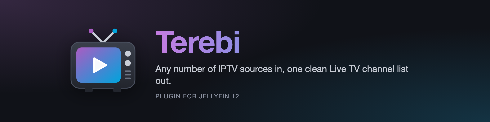
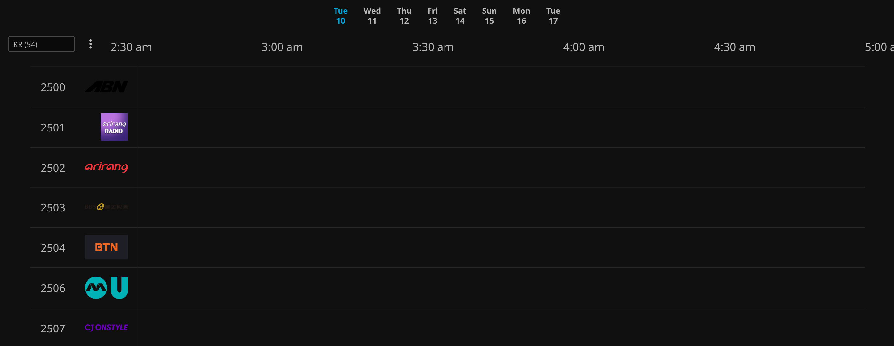

<p align="center"></p>

<p align="center">
  <a href="https://github.com/theqkash/jellyfin-plugin-terebi/releases/latest"></a>
  
  <a href="LICENSE"></a>
  <a href="https://discord.gg/CwH8XKRnpz"></a>
  <a href="https://ko-fi.com/theqkash"></a>
</p>

<p align="center"><b>Any number of IPTV sources in, one clean Live TV channel list out.</b><br>
Xtream and M3U sources merged into logical channels, with failover, health checks, EPG, logos and categories. <i>Terebi</i> is Japanese for TV.</p>

<p align="center"></p>

## Quick install

In Jellyfin open **Dashboard > Plugins > Repositories**, add

```
https://raw.githubusercontent.com/theqkash/jellyfin-plugins/main/manifest.json
```

then install **Terebi** from the Catalog and restart Jellyfin. Terebi ships no channels or playlists: bring your own sources, or start with the free public ones listed under [Where to find sources](#where-to-find-sources). Details are [below](#installation).

## Works best with

| Plugin | What it adds to Terebi |
| --- | --- |
| [File Transformation](https://github.com/IAmParadox27/jellyfin-plugin-file-transformation) | the category selector on Live TV > Channels and in the Guide, and the Terebi tab on the Live TV page (repository `https://www.iamparadox.dev/jellyfin/plugins/manifest.json`) |
| [Jellyfin.Xtream](https://github.com/Kevinjil/Jellyfin.Xtream) | not needed, but an existing setup can be imported in one click; disable it afterwards |

## Features


- **Sources**: Xtream Codes accounts and M3U playlists (URL or file), any number of each.
- **Logical channels**: a channel can be fed by several streams from different sources. Duplicates such as `TVN RAW`, `TVN HD`, `TVN FHD` and a free HLS copy of the same station become one channel with the streams ordered by quality and source priority.
- **Failover**: when a stream fails to start, stalls or ends, the next one is opened without the player noticing more than a hiccup. Every viewer of a channel shares one upstream connection, which matters for accounts limited to a single connection; the connection lingers a few seconds after the last viewer left so a player restart or a probe followed by playback does not reconnect to the provider. Channels in the folder tree are never marked as watched.
- **Health checks**: streams are probed the way a player would open them; dead ones move to the back of the queue and channels with no working stream disappear from the guide. Sources limited to one connection are not probed by default (a probe would take the account's only slot and viewers would be refused meanwhile); their streams are graded by real playback. A provider's "too many connections" answer (HTTP 458) is never counted as a dead stream.
- **Offline placeholders are dead streams**: Xtream panels do not fail an offline channel, they loop a short clip such as `black.ts`, which a player shows as a black screen. Terebi recognises the clip (by name in the HLS variant, or by the same finite chunk arriving again and again) and fails over instead of looping it.
- **Categories and numbers**: rules map provider categories and names to Terebi categories with fixed number blocks; everything else gets an automatic block per category. Jellyfin's Live TV UI has no channel groups, so the number blocks are what keeps the list navigable.
- **Names that follow the provider**: event channels (sport and PPV slots) can take their name from the provider on every refresh.
- **EPG**: XMLTV files (plain or gzip, streamed so 100 MB feeds are fine), the Xtream account's own `xmltv.php` feed, and the Xtream short EPG as a last resort. Channels without guide data are mapped to the XMLTV channel with the same name automatically; a mapping editor covers the rest. Channel icons declared by a feed (for example the Polish `https://epg.ovh/pltv.gz`) are used as logos.
- **Browsing by category**: Jellyfin's Live TV pages have no channel groups, so Terebi offers two ways around it. A "Terebi" entry under Channels shows one folder per category with the channels inside (works in every client, including TV apps). In the web client a category selector is added to Live TV > Channels and to the Guide when the File Transformation plugin is installed.
- **Logos that load and match**: provider logos are downloaded once into a local cache and Jellyfin only ever reads those files, so a slow or dead logo host can no longer stall the guide refresh or the web client. Logos are also looked up by name and country in the iptv-org channel database, which replaces the wrong pictures many providers ship; each source has a logo priority so a curated list can outrank a provider.
- **Parental control**: every channel carries its category as a tag, so blocking the tag `XXX` (or any other category) in a user's profile hides those channels from that user.
- **Export and import** of the whole setup (sources, channels, rules, EPG URLs) as JSON.
- **Admin UI** under Dashboard > Plugins > Terebi: sources, channel editor (merge, split, reorder streams, bulk edits), raw catalog browser, rules with presets, EPG mapping, live status of open streams.

No recording: Terebi is a Live TV provider (`ILiveTvService`), not a tuner, so Jellyfin's DVR does not apply.

## Where to find sources

You do not need a paid service to try Terebi. Free, legal playlists of publicly available channels are a good start:

- **[iptv-org/iptv](https://github.com/iptv-org/iptv)**: thousands of public channels from all over the world, as ready M3U playlists. Add any of them in Terebi as an M3U source by URL:
  - everything: `https://iptv-org.github.io/iptv/index.m3u`
  - one country (ISO code): `https://iptv-org.github.io/iptv/countries/pl.m3u`, `.../countries/jp.m3u`, `.../countries/kr.m3u`
  - one language: `https://iptv-org.github.io/iptv/languages/pol.m3u`
  - one category: `https://iptv-org.github.io/iptv/categories/news.m3u`, `.../categories/music.m3u`

  The playlists carry `tvg-id`s, so Terebi matches logos and guide data for most channels on its own. Set the source's country when you add a country playlist.
- **[iptv-org/epg](https://github.com/iptv-org/epg)**: tools and ready XMLTV guides for many of those channels; paste an XMLTV URL into the EPG tab.
- **[awesome-iptv](https://github.com/iptv-org/awesome-iptv)**: a curated list of more playlists, EPG sources, players and tools.

Free lists change often and some streams are geo-blocked or go offline; Terebi's health checks hide dead ones and fail over to another source of the same channel automatically. Only add sources you are allowed to use.

## Requirements

- Jellyfin 12.0 or newer (the plugin targets .NET 10).
- At least one Xtream account or M3U playlist; free public playlists work fine (see [Where to find sources](#where-to-find-sources)).
- Optional: the [File Transformation](https://github.com/IAmParadox27/jellyfin-plugin-file-transformation) plugin for the category selector in the web client.

## Installation

1. In Jellyfin open Dashboard > Plugins > Repositories and add:

   ```
   https://raw.githubusercontent.com/theqkash/jellyfin-plugins/main/manifest.json
   ```

2. Open the Catalog, install Terebi, restart Jellyfin. The same repository also lists the other plugins from https://github.com/theqkash/jellyfin-plugins.

Manual install: download the zip from [Releases](https://github.com/theqkash/jellyfin-plugin-terebi/releases) and unpack it into `<jellyfin data>/plugins/Terebi_<version>/`.

## Getting started

The plugin ships with no sources and no rules. Everything below is done in Dashboard > Plugins > Terebi.

1. **Sources**: add your Xtream account (the plugin reads `max connections` from the account) and any M3U playlists, as many as you like. Each source has:
   - a **priority** (lower wins when several sources carry the same channel),
   - optional **include / exclude** regexes on the provider's category names, so only the parts of a big account you care about are imported,
   - an optional **category label** that puts every channel of the source into one Terebi category (handy for thematic or regional free lists),
   - an optional **country** (ISO code such as `PL` or `JP`) used for logo and EPG lookups when the names carry no region prefix,
   - optional **XMLTV URLs**, and for Xtream accounts a switch for the account's own `xmltv.php` feed.
2. **Status > Refresh sources now**. The catalog is downloaded and the lineup is built; check the **Channels** tab.
3. **Rules** (optional, see below), then refresh again.
4. **Status > Check stream health**, then refresh again later; dead streams get marked after two failed probes.
5. **EPG**: paste XMLTV URLs, download, then use the mapping suggestions for channels without guide data.
6. Dashboard > Live TV > **Refresh Guide** (or the button on the Status tab) to push the channel list into Jellyfin.

Migrating from the Jellyfin.Xtream plugin: **Status > Import from Xtream plugin** creates the source from the existing configuration and remembers the channel numbers it had; after the first refresh use **Channels > Apply imported numbers**. Disable the Xtream plugin afterwards so the account is not used twice.

## Rules: categories and channel numbers

Without rules every stream becomes a channel in its provider category, numbered after the provider. Rules let you decide the layout yourself. A rule has:

| Field | Meaning |
|---|---|
| Sources | which sources the rule applies to; empty = all of them |
| Category pattern | regex matched against the provider's category name |
| Name pattern | regex matched against the stream name |
| Category | the Terebi category the matching channels go to |
| Numbers from | first channel number of that category's block |
| Auto-add | new streams matching the rule become channels automatically |
| Follow name | the channel is renamed whenever the provider renames the stream (event and PPV slots) |
| Exclude | matching streams are dropped instead |

Rules are evaluated from top to bottom and the **first match wins**; a channel fed by several streams takes the category of the earliest rule any of its streams matched. So put specific rules first and catch-alls last. Typical recipes:

- *A free list as its own block*: add the list as a source with the category label `JP` (no rule needed), or add a rule limited to that source with category pattern `.`, category `JP`, numbers from `2000`.
- *Provider categories mapped to your own*: one rule per category with a category pattern matching what your provider calls it (for example `SPORT`), your own category name and a number block.
- *Sorting by channel name*: name patterns such as `TVN ?24|TVP ?INFO|POLSAT NEWS` into `News` from `200`; useful when a provider's categories are messy or when free lists have none.
- *Adult content last*: category pattern `XXX|ADULT`, category `XXX`, numbers from `10000`; block the tag `XXX` in the profiles of users who should not see it.

**Rules > Load preset** gives you a starting point: `generic` (separator entries skipped, adult, PPV and seasonal categories moved to the end) and `pl` (Polish channels sorted into news, movies, sport, documentary, kids, music, regional and entertainment blocks by channel name). Presets reference no sources and no provider category names, so they work with any account; edit them freely afterwards.

## How matching works

Streams from different sources are also joined when their names resolve to the same channel in the iptv-org database (so "NIPPON TV", "JOAX-DTV" and "日テレ" become one channel); set the source's country when its names carry no region prefix. A playlist's `url-tvg` header is picked up as the source's EPG when no EPG URL is configured.

Every provider name is normalised: the region prefix (`XX|`, `XX:`, `XX-TAG|`), bracketed tags, quality markers (`RAW`, `HD`, `FHD`, `SD`, `HEVC`, `1080p`...), and noise words (`VIP`, `BACKUP`, `LINK 2`) are stripped, punctuation removed, case folded. Streams with the same key, or the same `tvg-id` / `epg_channel_id`, join the same channel. Streams that no longer exist at the provider are re-found by their last known name and category, because some providers recycle stream ids for event channels.

Anything you change by hand pins the channel: automatic matching keeps attaching new streams but never touches its name, number or category again.

## Data

Everything lives under `<jellyfin data>/terebi/`: `sources.json`, `lineup.json`, `catalog/<source>.json`, `health.json`, `epg/`, `logos/` (cached logo files, `cache.json`, and the reduced iptv-org index). All plain JSON, safe to back up or edit while Jellyfin is stopped.

## API

All endpoints are under `/Terebi` and require an administrator session: `Status`, `Sources`, `Catalog`, `Channels` (with `Merge`, `Split`, `Bulk`, `Rebuild`, `Suggestions`), `Rules`, `Health/Run`, `Health/Probe`, `Epg/*`, `Guide/Refresh`, `Import/XtreamPlugin`, `Import/ApplyNumbers`.

## Building

```
dotnet build Jellyfin.Plugin.Terebi/Jellyfin.Plugin.Terebi.csproj -c Release
```

Requires the .NET 10 SDK. `./build-release.sh [version]` builds the zip the catalog expects and updates `manifest.json`; the GitHub workflow does the same when a tag such as `v0.1.1.0` is pushed.

## Community and support

Questions, ideas and bug reports are welcome on [Discord](https://discord.gg/CwH8XKRnpz) or in the issues here. If the plugin saves you time, you can buy me a coffee on [Ko-fi](https://ko-fi.com/theqkash).

## License

MIT
